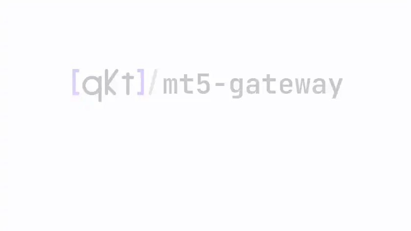

<p align="center">
  <picture>
    <source media="(prefers-color-scheme: dark)" srcset="docs/assets/mt5-gateway-logo-dark.svg">
    
  </picture>
</p>

<h3 align="center">MetaTrader 5 as a REST API.<br/>Headless, in Docker. No Windows, no desktop.</h3>

<p align="center">
  <a href="https://github.com/elitekaycy/mt5-gateway/actions/workflows/check.yml"></a>
  <a href="LICENSE"></a>
  <a href="https://hub.docker.com/r/elitekaycy/mt5-gateway-api"></a>
</p>

<p align="center">
  <a href="docs/assets/mt5-gateway-full-dark.mp4">
    <picture>
      <source media="(prefers-color-scheme: dark)" srcset="docs/assets/mt5-gateway-loop-dark.webp">
      
    </picture>
  </a>
</p>

<p align="center"><sub>Every command in this clip was run for real, against a demo account.<br/><a href="docs/assets/mt5-gateway-full-dark.mp4">Watch the full walkthrough</a></sub></p>

<br/>

## What it is

Trade, stream prices and read account state over plain HTTP. Give it a broker login and a server name and it
logs itself in on boot: no VNC session, no installer, no broker directory file.

```text
your code ──HTTP──▶ mt5-gateway ──▶ MetaTrader 5 (Wine) ──▶ your broker
```

It is the broker bridge for [qkt](https://github.com/elitekaycy/qkt), and works for any code that can make an HTTP
request.

> [!WARNING]
> It can place real trades on real accounts. Start with a demo account.

<br/>

## Quick start

**1. Pull the image**

```bash
docker pull elitekaycy/mt5-gateway-api:latest
```

**2. Start it with your account**

```bash
docker volume create mt5-gateway-config

docker run -d --name mt5-gateway \
  --restart unless-stopped \
  -p 127.0.0.1:5001:5001 \
  -v mt5-gateway-config:/config \
  -e MT5_LOGIN=12345678 \
  -e MT5_PASSWORD='your-trading-password' \
  -e MT5_SERVER=Exness-MT5Trial9 \
  -e API_KEY='change-this-long-random-token' \
  elitekaycy/mt5-gateway-api:latest
```

**3. Wait until it is ready**

```bash
export API_KEY='change-this-long-random-token'

curl -H "Authorization: Bearer $API_KEY" \
  http://localhost:5001/health/ready
```

You will see `"status": "ready"` and `"mt5_status": "connected"`. That is the gateway logged in and trading-ready.

**4. Find your broker's symbol, then place an order**

Brokers name symbols their own way: this one calls EURUSD `EURUSDm`.

```bash
curl -H "Authorization: Bearer $API_KEY" \
  "http://localhost:5001/symbols?search=*EURUSD*"

curl -X POST http://localhost:5001/order \
  -H "Content-Type: application/json" \
  -H "Authorization: Bearer $API_KEY" \
  -H "Idempotency-Key: demo-$(date +%s)" \
  -d '{"symbol": "EURUSDm", "volume": 0.01, "type": "BUY"}'
```

A `"state": "executed"` reply means the order is filled. Close it with `POST /close_all_positions`, or open the
interactive API at `http://localhost:5001/apidocs`.

<br/>

## Next

| I want to | Read |
| --- | --- |
| Call every endpoint | [API reference](https://mt5.tryqkt.com/reference/api/) |
| Change a setting | [Configuration](https://mt5.tryqkt.com/reference/configuration/) |
| Run it in production | [Production deploy](https://mt5.tryqkt.com/get-started/production-deploy/) |
| Trade with qkt | [Using with qkt](https://mt5.tryqkt.com/connect/qkt/) |
| Understand headless login | [How it works](https://mt5.tryqkt.com/concepts/why-headless-login/) |
| Keep it safe | [Health and safety](https://mt5.tryqkt.com/operations/health-and-safety/) · [SECURITY.md](SECURITY.md) |
| Contribute | [CONTRIBUTING.md](CONTRIBUTING.md) |

<br/>

<sub>MIT licensed. Started from [slowfound](https://github.com/slowfound)'s [metatrader5-quant-server-python](https://github.com/slowfound/metatrader5-quant-server-python) and his [tutorial series](https://youtube.com/playlist?list=PLotEOI0Sz3OzdSp7qR6vHs8EYnmQwqWAF), carried on by [Gabriel Rockson](https://github.com/Gabriel-Rockson) in [mt5-gateway](https://github.com/Gabriel-Rockson/mt5-gateway), and developed here by [Dickson Anyaele](https://github.com/elitekaycy).</sub>
